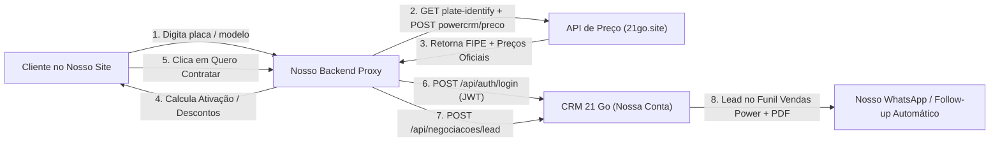

# 21Go — Pesquisa Técnica & Arquitetura de Automação de Vendas

Documentação completa do mapeamento técnico realizado no ecossistema **21Go** (`https://21go.site/cotacao` e `https://www.crm21go.site`) com foco em **automação completa do funil de vendas para franquia/consultor**.

---

## Resumo Executivo

1. **Cotação com preço oficial em tempo real (`21go.site`):**
   - O site público expõe endpoints REST abertos que consultam placa, tabela FIPE (marcas/anos/modelos) e **calculam os preços oficiais de todos os planos** diretamente no motor do PowerCRM (`POST https://21go.site/api/vehicle/powercrm/preco`).
   - As regras complementares (taxa de ativação, desconto de pontualidade de 5%, desconto de adesivo 10%/15%, adicional de terceiros para moto e regras de vistoria presencial) rodam no front-end e foram totalmente mapeadas.
2. **Captura 100% para a nossa conta (`crm21go.site`):**
   - Ao construir nosso próprio site de cotação, consultamos **apenas** a placa/FIPE e o endpoint de preço (`/api/vehicle/powercrm/preco`), **sem chamar** `/api/vehicle/lead` no site da matriz.
   - Quando o cliente decide avançar ou contratar, o lead é enviado diretamente para o **nosso funil no CRM 21 Go** (`https://www.crm21go.site/api`) autenticado com o token JWT da nossa conta de vendedor — garantindo 100% de atribuição para a franquia — e direcionado para o **nosso WhatsApp**.
3. **Automação de ponta a ponta da venda:**
   - A API interna do `crm21go.site` permite automatizar criação de lead, geração/ajuste de cotação, envio do link de proposta em PDF, movimentação entre todas as 5 etapas do funil **Vendas Power**, criação de tarefas, integração com WhatsApp/ISA, pedido de documentos de vistoria e fechamento (ganho/perdido).

---

## Fluxo Arquitetural Proposto



---

## Rodando o site

```bash
pnpm install
cp .env.example .env   # preencha ao menos FRANQUIA_WHATSAPP
pnpm dev               # http://localhost:3000
pnpm build             # build de produção (output standalone, usado pelo Dockerfile)
```

- `FRANQUIA_WHATSAPP` (DDI + DDD + número, só dígitos) alimenta os botões de WhatsApp da página e a mensagem do lead. Sem ela, o site usa o número de exemplo `5521999999999`.
- A página (`src/app/page.tsx`) lê a variável a cada requisição, então trocar o valor no Coolify e reiniciar basta; não precisa refazer o build.
- Tipografia (Barlow e Barlow Condensed) vem do pacote `@fontsource`, sem chamadas ao Google Fonts.
- Placa com mais de um modelo compatível mostra a lista para a pessoa escolher; placa achada pela metade leva para a busca por marca e modelo.

---

## Índice da Documentação

| Arquivo | Conteúdo |
|---|---|
| [`docs/01-api-cotacao-21go-site.md`](./docs/01-api-cotacao-21go-site.md) | Endpoints de placa, FIPE, cálculo de preço (`powercrm/preco`), regras de ativação/descontos no front-end e roteamento de consultor (`/{slug}`). |
| [`docs/02-api-crm21go.md`](./docs/02-api-crm21go.md) | Autenticação JWT, identificação de vendedor/empresa, UUIDs das 5 etapas do funil **Vendas Power** e mapa completo de endpoints do CRM. |
| [`docs/03-arquitetura-automacao-vendas.md`](./docs/03-arquitetura-automacao-vendas.md) | Plano completo de automação de vendas (etapa por etapa), opções de implementação (Site Próprio + Node.js/Next.js ou n8n) e próximos passos. |

---

## Segurança

- Nenhuma credencial, senha ou token JWT real está armazenado neste repositório.
- Utilize `.env` local (baseado em [`.env.example`](./.env.example)) ao implementar o backend intermediário.
