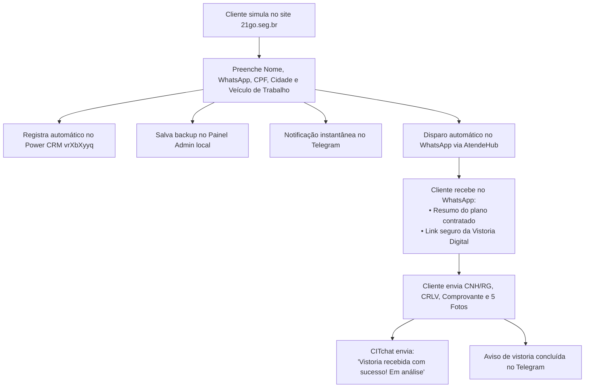

# 21Go — Plataforma de Vendas Automatizadas & Engenharia Reversa

Documentação técnica completa e código-fonte da plataforma de vendas e vistoria 100% automatizada da franquia **21Go Proteção Veicular** (Grupo CITmax), integrada com o **Power CRM**, painel interno de backup, notificações instantâneas no **Telegram** e atendimento omnicanal com o aplicativo **CITchat** via **AtendeHub**.

---

## 1. Visão Geral da Arquitetura

1. **Cotação Oficial em Tempo Real:**
   - Consulta instantânea de placa e tabela FIPE com cálculo dos preços oficiais de todos os planos diretamente no motor do PowerCRM (`POST /api/vehicle/powercrm/preco`).
   - Aplicação de regras comerciais: taxa de adesão/cadastro, 5% de desconto de pontualidade, 10% a 15% de desconto de adesivo e adicionais de cobertura.
2. **Registro 100% no CRM (Sem Desviar para WhatsApp Pessoal):**
   - Os leads são enviados diretamente ao **Power CRM** da 21Go via endpoint público `POST https://app.powercrm.com.br/svQttnDynmcFrm` atribuídos ao código do consultor `vrXbXyyq` (`CITmax`).
   - Cada lead é espelhado no funil de vendas (`6d5d6fbc-acbc-4c35-aff6-60c0f30abf28`).
3. **Painel de Backup Local (`/admin`):**
   - Armazenamento persistente de todos os leads e vistorias em banco de dados interno local (`data/leads.json`), com busca, filtros por status, visualização completa e exportação para CSV.
4. **Vistoria Digital Própria (`/vistoria`):**
   - Formulário digital que coleta os documentos exigidos pela associação:
     - CNH (ou RG na ausência de CNH)
     - Documento do Veículo (CRLV)
     - Comprovante de Residência
     - 5 fotos do veículo (frente, traseira, laterais e odômetro/KM)
5. **Notificações Instantâneas no Telegram:**
   - Alertas imediatos enviados para o Telegram do consultor/equipe a cada nova simulação e a cada vistoria submetida com links diretos.
6. **Integração com WhatsApp via CITchat / AtendeHub:**
   - O Grupo CITmax utiliza atendimento omnicanal com IA e WhatsApp Oficial da Meta conectado no AtendeHub. Disparo automático de cotação e link de vistoria para o WhatsApp do cliente.

---

## 2. Fluxo da Automação



---

## 3. Índice da Documentação

| Arquivo | Descrição |
|---|---|
| [`docs/01-api-cotacao-21go-site.md`](./docs/01-api-cotacao-21go-site.md) | Mapeamento da API de cotação do `21go.site`, consulta de placa, FIPE e cálculo de planos. |
| [`docs/02-api-crm21go.md`](./docs/02-api-crm21go.md) | Engenharia reversa do CRM 21 Go (`crm21go.site`), JWT, UUIDs de etapas do funil. |
| [`docs/03-arquitetura-automacao-vendas.md`](./docs/03-arquitetura-automacao-vendas.md) | Especificação arquitetural do funil de vendas automatizado de ponta a ponta. |
| [`docs/04-api-powercrm-reversa.md`](./docs/04-api-powercrm-reversa.md) | Engenharia reversa do Power CRM (`app.powercrm.com.br`), submissão pública sem auth, limites do consultor e documentos obrigatórios. |
| [`docs/05-integracao-citchat-atendehub.md`](./docs/05-integracao-citchat-atendehub.md) | Integração omnicanal com CITchat e AtendeHub do Grupo CITmax para envio e recebimento de WhatsApp. |

---

## 4. Estrutura do Projeto

```
.
├── docs/                      # Documentação técnica e engenharia reversa
│   ├── 01-api-cotacao-21go-site.md
│   ├── 02-api-crm21go.md
│   ├── 03-arquitetura-automacao-vendas.md
│   ├── 04-api-powercrm-reversa.md
│   └── 05-integracao-citchat-atendehub.md
├── src/
│   ├── app/
│   │   ├── page.tsx           # Landing page responsiva com cotador de placa e planos
│   │   ├── vistoria/          # Página de vistoria digital com upload de documentos/fotos
│   │   ├── admin/             # Painel administrativo de backup e gestão de leads
│   │   └── api/               # Rotas de cotação, PowerCRM, DB local e Telegram
│   └── lib/                   # Clientes de API, tipos, cálculo de preços e banco local
├── Dockerfile                 # Multi-stage build standalone para VPS / Coolify
└── docker-compose.yml         # Configuração de orquestração local/VPS
```

---

## 5. Segurança & Boas Práticas

- Nenhuma chave de API ou credencial confidencial é versionada no repositório.
- A comunicação entre o backend e os provedores utiliza variáveis de ambiente seguras (`.env`).

---

## 6. Pagamento da adesão via Pix (Mercado Pago)

Fluxo: cotação → cadastro → **`/pagamento`** (Pix) → confirmação automática → link da vistoria por WhatsApp → vistoria → aprovação no `/admin`.

- **Cobrança:** Orders API (`POST /v1/orders`, Pix). Código em `src/lib/mercadopago.ts`.
- **Valor confiável:** a cotação devolve um token assinado (`QUOTE_SIGNING_SECRET`); no cadastro o servidor usa a adesão que ele mesmo calculou e ignora o valor enviado pelo navegador.
- **Confirmação (3 camadas, todas idempotentes):** webhook `order` assinado (`/api/webhooks/mercadopago`), polling da página `/pagamento` e um reconciliador a cada 60 s (`src/instrumentation-node.ts`).
- **Vistoria bloqueada até o Pix ser pago** (`402` na API e redirecionamento na página).

### Configuração
1. Em *Suas integrações* do Mercado Pago, copie o **Access Token** → `MP_ACCESS_TOKEN`.
2. Em *Webhooks*, cadastre `https://SEU-DOMINIO/api/webhooks/mercadopago` com o evento **Order (Mercado Pago)** e copie a **assinatura secreta** → `MP_WEBHOOK_SECRET`.
   Se a mesma aplicação já aponta o webhook para outro site, as notificações não chegam aqui — o polling/reconciliador cobre isso, mas o ideal é uma aplicação separada.
3. Defina `QUOTE_SIGNING_SECRET`, `SESSION_SECRET` e `ADMIN_PASSWORD` (`openssl rand -hex 32`). Sem `ADMIN_PASSWORD` o painel fica bloqueado.
4. Monte um volume persistente em `/app/data` (cadastros em `leads.json`) e defina `NEXT_PUBLIC_APP_URL`.

Sem `MP_ACCESS_TOKEN` o site volta ao comportamento anterior (checkout do Power CRM, sem bloqueio de vistoria).
Todas as variáveis estão em [`.env.example`](./.env.example).

### Etapas que continuam manuais
Gerar vistoria dentro do CRM da franqueadora e "Enviar ao Hinova SGA" dependem de endpoints internos do CRM 21Go (sem API oficial). O Telegram avisa cada marco e o `/admin` mostra o próximo passo.
