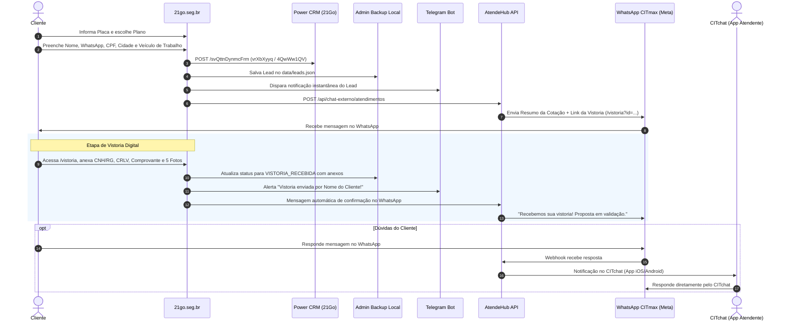

# Integração WhatsApp: CITchat & AtendeHub (Grupo CITmax)

Este documento especifica a integração entre a plataforma de vendas automatizada (`21go.seg.br`) e o ecossistema de comunicação omnicanal do **Grupo CITmax** via **AtendeHub** (`https://atendai.citmax.com.br` / `https://atendehub.170.82.252.195.sslip.io`) e aplicativo móvel **CITchat**.

---

## 1. Visão do Grupo CITmax

A **CITmax** atua como um grupo multisserviços com diferentes unidades de negócio unificadas sob a mesma infraestrutura de atendimento com IA:

1. **CITmax Telecom:** Provedor de internet fibra óptica de alta velocidade e telefonia.
2. **CITmax Proteção Veicular:** Franquia e consultoria de proteção patrimonial 21Go em âmbito regional (RN) e nacional.
3. **CITmax Delivery / Shop:** Soluções de tecnologia e comércio eletrônico.

O canal oficial de WhatsApp do grupo está conectado via **Meta Cloud API Oficial** (`meta:997863210075519`) com alta entregabilidade e sem risco de bloqueio.

---

## 2. Fluxo 100% Automatizado de Vendas & Vistoria



---

## 3. Endpoints da API AtendeHub para Integração

### Iniciar Atendimento WhatsApp Outbound
Dispara o primeiro contato com o cliente assim que a simulação for concluída no site:

```http
POST /api/chat-externo/atendimentos
Host: atendai.citmax.com.br
Authorization: Bearer ak_<CHAVE_API_SISTEMA_EXTERNO>
Content-Type: application/json
```

#### Payload:
```json
{
  "canalId": "canal_meta_citmax_id",
  "telefone": "84999999999",
  "nomeContato": "Clebson Isaias",
  "deIdExterno": "21go-bot",
  "texto": "Olá Clebson! 🚗\n\nRecebemos sua simulação na 21Go Proteção Veicular!\n\nSeu veículo: FIAT MOBI LIKE 2021\nPlano Selecionado: VIP (Proteção Completa + Roubo/Furto + Guincho 24h + Carro Reserva)\n\nPara ativarmos sua proteção com o Desconto Pontualidade, conclua o envio da documentação e fotos no link seguro abaixo:\n\n👉 https://21go.seg.br/vistoria?leadId=lead_123456\n\nQualquer dúvida, é só responder esta mensagem!"
}
```

---

## 4. IA e Roteamento Multisserviços no AtendeHub

Como o número WhatsApp da CITmax atende clientes de Internet e de Proteção Veicular, o prompt do agente inteligente (`ContextoPrompt` em `apps/api/src/ai/prompt.ts`) identifica a intenção do cliente:

- **Se perguntar sobre Internet / Suporte / Conexão:** Roteia para os fluxos do SGP (2ª via de fatura, teste de rota/ONU, abertura de O.S.).
- **Se perguntar sobre Proteção Veicular / Seguro / Cotação:** A IA explica as coberturas da 21Go (cobertura nacional FIPE, guincho, sem perfil de condutor, assistência 24h) e fornece o link oficial do cotador `https://21go.seg.br`.
- **Se for um lead em vistoria:** Acompanha o status e encaminha para o corretor responsável no aplicativo CITchat.
