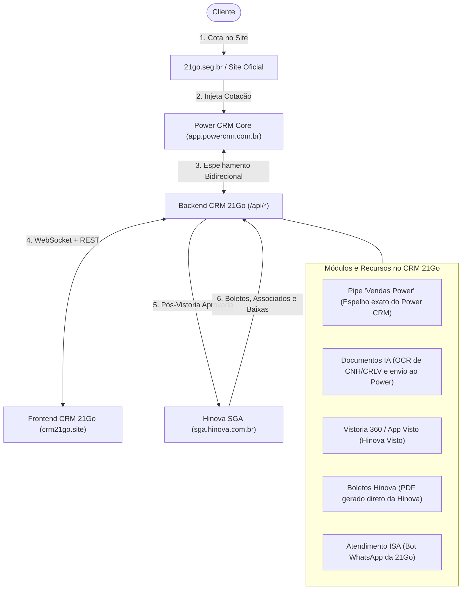

# Engenharia Reversa Completa: CRM 21Go (`crm21go.site`) vs PowerCRM vs Hinova SGA

Este documento consolida a análise detalhada e a engenharia reversa completa do frontend, bundles de produção, requisições de rede, WebSockets e backend do **CRM 21Go** (`https://www.crm21go.site/`).

---

## 1. Veredito Final: Os dados vêm do mesmo canto?

**SIM, 100% COMPROVADO.**

O `crm21go.site` não é um CRM com dados isolados. Ele funciona como uma **plataforma unificada (BFF - Backend for Frontend + Espelho)** construída pela 21Go que agrega e orquestra em tempo real dois sistemas mestres:

1. **Power CRM (`app.powercrm.com.br`)**: Gerencia o funil de vendas, cotações, simulações, envio de propostas e dados de consultores.
2. **Hinova SGA (`sga.hinova.com.br`)**: ERP mestre da Hinova para gestão de associados, veículos ativos, consulta e geração de boletos com PDF e conciliação financeira.

---

## 2. Arquitetura Técnica do CRM 21Go

- **Frontend**: React + Vite + Tailwind CSS + React Query + React Router + Zustand (armazenando JWT em `localStorage: crm-auth-storage`).
- **Mobile Nativo**: Capacitor (`Capacitor.isNativePlatform()`).
- **Tempo Real**: **Socket.IO** (`/socket.io/?EIO=4`) conectado à sala `company:${user.companyId}` para notificações instantâneas.
- **Backend / BFF**:
  - Web: `https://www.crm21go.site/api/*` (porta local `3333` em dev).
  - O navegador nunca chama diretamente o PowerCRM ou a Hinova; todo o tráfego é intermediado pelo backend próprio da 21Go, que faz o espelhamento bidirecional.

---

## 3. Mapeamento Completo de Endpoints e Integrações

### A. Integração com o Power CRM
* **Funil Espelhado**: O pipe `Vendas Power` (`a41be931-04d2-46da-a0c4-1406c3c4e114`) possui as 5 etapas fixas espelhadas do Power CRM:
  1. *Cotações recebidas*
  2. *Em negociação*
  3. *Vistorias*
  4. *Liberadas para cadastro*
  5. *Vendas concretizadas*
* **Cotações e Negociações no Power**:
  * `POST /api/cotacao-rapida`: Cria a cotação instantaneamente no Power e retorna os planos cadastrados.
  * `POST /api/negociacoes/lead`, `POST /api/negociacoes/planos`, `PUT /api/negociacoes/:id/plano`, `POST /api/negociacoes/:id/mover`, `POST /api/negociacoes/:id/aceite`.
  * `PUT /api/negociacoes/:id/cotacoes/:cotId/adicionais`: Salva adicionais na observação interna do termo do Power.
* **Sincronização de Contato e Anexos**:
  * `PUT /api/pipes/cards/:id/contato`: Salva no cadastro do associado e replica no PowerCRM.
  * `GET /api/pipes/cards/:id/anexos-power`: Lê os anexos salvos diretamente no card do PowerCRM.
  * `POST /api/pipes/cards/:id/documentos/:docId/power`: Anexa documentos diretamente no Power.
  * `GET /api/vistoria-propria/:id/arquivar/placas` e `POST /api/vistoria-propria/:id/arquivar`: Arquiva placas selecionadas no Power com motivo e justificativa.
* **Criação de Usuários**:
  * `GET /api/contas-power/opcoes` e `POST /api/contas-power`: Provisiona o consultor na hora dentro do PowerCRM.

---

### B. Integração com o Hinova SGA
* **Consulta e Cadastro**:
  * `GET /api/sga/:id/consultar` e `GET /api/sga/:id/vencimentos`.
  * `GET /api/sga/:id/pre-checagem`, `GET /api/sga/:id/opcoes`.
  * `POST /api/sga/:id/enviar`: Dispara associado e veículo para cadastro efetivo no SGA após aprovação da vistoria.
* **Base de Associados**:
  * `GET /api/associados/base`, `/associados/base/resumo`, `/associados/base/recursos`, `/associados/base/aniversariantes`: Consome toda a base de associados diretamente do SGA.
* **Boletos Hinova**:
  * `GET /api/boletos`, `/boletos/resumo`, `GET /api/boletos/:nossoNumero/link`: Baixa o PDF do boleto direto da Hinova e valida status de pagamento (`PAGO`, `CANCELADO`, `EXIGE_REVISTORIA`), conciliando com o campo `donoFontePower`.
* **Sincronização de Rede e Vendas**:
  * `GET /api/rede/arvore`, `/rede/placar`, `/rede/placas`, `/rede/vendas`, `POST /api/rede/sync`, `GET /api/rede/sync/:jobId`: Job assíncrono que puxa as placas pagas e ativas no SGA.

---

### C. Motores de Vistoria e IA
* **Vistoria Tradicional (App Visto Hinova)**:
  * `/api/vistorias/opcoes`, `/vistorias/:id/estado`, `/vistorias/:id/liberar` (gera o código numérico para o App Visto mobile com geolocalização e câmera travada).
* **Vistoria 360 / Própria (Web)**:
  * `/api/vistoria-propria/:id`, `/renovar-link`, `/desfazer-link`, `/termo-adesao.pdf`.
* **Documentos IA**:
  * `GET /api/documentos-ia/liberado`, `GET/POST /api/documentos-ia/negociacao/:id(/anexar|/ler|/aplicar)`: Extrai dados de CNH, CRLV e comprovante via inteligência artificial e preenche os campos no PowerCRM.

---

### D. Atendimento WhatsApp e Bot ISA
* `GET/POST /api/atendimento-isa/*` (`bot`, `conversa`, `responder`, `responder-arquivo`, `responder-audio`, `transferir`, `resolvido`, `funil`, `lucro`, `lembretes`).
* `POST /api/whatsapp/reconfigure-webhook`: Configura a URL pública do webhook do canal de WhatsApp.

---

## 4. Comparativo de Responsabilidades

| Recurso | Power CRM | Hinova SGA | CRM 21Go (`crm21go.site`) |
| :--- | :---: | :---: | :---: |
| **Origem do Lead** | ✅ Mestre | ❌ | ✅ Consome/Espelha |
| **Cálculo da Cotação FIPE** | ✅ Mestre | ❌ | ✅ Consome do Power |
| **Funil Comercial (5 Fases)** | ✅ Mestre | ❌ | ✅ Espelho visual |
| **Vistoria (App Visto)** | ✅ Mestre | ✅ Mestre | ✅ Gera código |
| **Contrato & Cadastro Ativo** | ❌ | ✅ Mestre | ✅ Envia para o SGA |
| **Emissão de Boleto & PDF** | ❌ | ✅ Mestre | ✅ Consulta em tempo real |
| **Bot WhatsApp (ISA / IA)** | ❌ | ❌ | ✅ Módulo Exclusivo |
