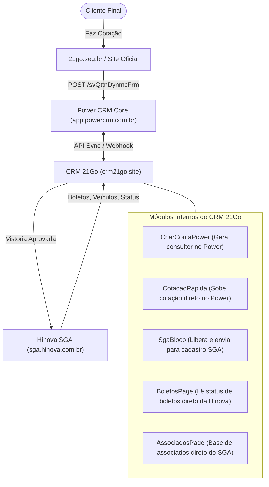

# Engenharia Reversa: CRM 21Go (`crm21go.site`) vs PowerCRM vs Hinova SGA

Este documento consolida a análise detalhada e a engenharia reversa executada sobre o frontend e os bundles de produção do **CRM 21Go** (`https://www.crm21go.site/`).

---

## 1. Conclusão Direta: Os dados vêm do mesmo canto?

**SIM, 100% CONFIRMADO.**

O `crm21go.site` não possui uma base de dados isolada de clientes ou cotações. Ele é um **Portal Customizado / Hub Unificado (BFF)** construído sob medida pela 21Go que se conecta diretamente a dois sistemas mestres:

1. **Power CRM (`app.powercrm.com.br`)**: Gerenciador de funil comercial, cotações, simulações e dados de consultores.
2. **Hinova SGA (`sga.hinova.com.br`)**: ERP mestre de proteção veicular para associados, veículos, boletos e emissão de cobranças.

---

## 2. Evidências Extraídas do Código-Fonte (Chunks JS)

A inspeção dos bundles estáticos (`/assets/*.js`) revelou as seguintes chamadas de API, comentários internos e literais de código:

### A. Integração com o Power CRM
* **Criação de Usuários / Consultores**:
  * Chunk: `CriarContaPowerPage-kF3rEMm4-g61.js`
  * Trechos:
    > *"A conta é criada no Power na hora, e a senha é gerada em seguida."*
    > *"É o nome que aparece no funil do Power."*
    > Endpoints: `POST /power/criar-conta`, `GET /contas-power/opcoes`, `GET /power/status`
* **Criação de Cotações Rápidas**:
  * Chunk: `CotacaoPage-Bk3AKDLH-g61.js`
  * Trechos:
    > *"Cotação criada no Power"*
    > *"A cotação sobe direto no Power e os planos abaixo são os que o próprio Power devolve."*
    > Endpoint: `POST /cotacao-rapida`
* **Arquivamento e Negociações**:
  * Chunk: `ArquivarPower-g61.js`
  * Trechos:
    > *"// Arquivar POR PLACA no Power: escolhe a(s) placa(s), o motivo e a descrição..."*
    > Endpoints: `GET /vistoria-propria/${a}/arquivar/placas`, `POST /vistoria-propria/${a}/arquivar`

---

### B. Integração com o Hinova SGA
* **Consulta da Base de Associados**:
  * Chunk: `AssociadosPage-CACUdZ7g-g61.js`
  * Trecho:
    > *"base inteira da 21Go — direto do SGA."*
    > Endpoints: `GET /associados/base`, `GET /associados/base/resumo`, `POST /associados/base/link-vistoria`
* **Consulta e Status de Boletos Hinova**:
  * Chunk: `BoletosPage-B3ceqmwt-g61.js`
  * Trechos:
    > *"O SGA acabou de confirmar: este boleto foi PAGO. Retirado da cobrança."*
    > *"O SGA diz que este boleto foi CANCELADO. Não há o que cobrar."*
    > *"Não deu para falar com o sistema da Hinova agora. Tente de novo em instantes."*
    > *"Abre o PDF do boleto direto da Hinova"*
* **Envio para Cadastro SGA**:
  * Chunk: `SgaBloco-ByUK8qIy-g61.js`
  * Trechos:
    > *"Vistoria aprovada pelo time interno. O cadastro no SGA segue pelo caminho de sempre — esta etapa ainda não é automática."*
    > *"Associado e veículo enviados ao SGA"*
    > Endpoints: `GET /sga/${a}/pre-checagem`, `GET /sga/${a}/opcoes`, `POST /sga/${a}/enviar`

---

### C. Sistema Duplo de Vistorias no CRM 21Go
O CRM 21Go suporta dois motores de vistoria:
1. **App Visto (Hinova / Power CRM)**:
   - Utiliza código numérico (`inspectionRequestCode`).
   - Texto de sistema: *"Vistoria liberada — código gerado no App Visto"*.
   - Decisão final: *"A decisão desta vistoria (aprovar, devolver ou reprovar) é do time interno, no Power."*
2. **Vistoria Própria 21Go (Web)**:
   - Link web gerado diretamente pelo portal (`/vistoria-propria/${a}`).
   - Utilizado para clientes que preferem fazer pelo navegador sem instalar o App Visto.

---

## 3. Resumo da Topologia

| Sistema | O que armazena / gerencia | Como se relaciona com o CRM 21Go |
| :--- | :--- | :--- |
| **Power CRM** | Leads, cotações, funil de vendas (5 fases), consultores, comissões | O CRM 21Go lê e escreve no Power CRM em tempo real via API backend |
| **Hinova SGA** | Contratos ativos, veículos cadastrados, boletos emitidos e baixas financeiras | O CRM 21Go consulta a base de associados e envia veículos aprovados |
| **CRM 21Go (`crm21go.site`)** | Interface unificada web para corretores e time interno da 21Go | Atua como uma camada visual sobre o Power CRM e o Hinova SGA |
| **Site 21Go (`21go.seg.br`)** | Formulário público de cotação online e autoatendimento | Injeta novos leads e cotações direto no Power CRM (Funnel ID `6d5d6fbc...`) |
