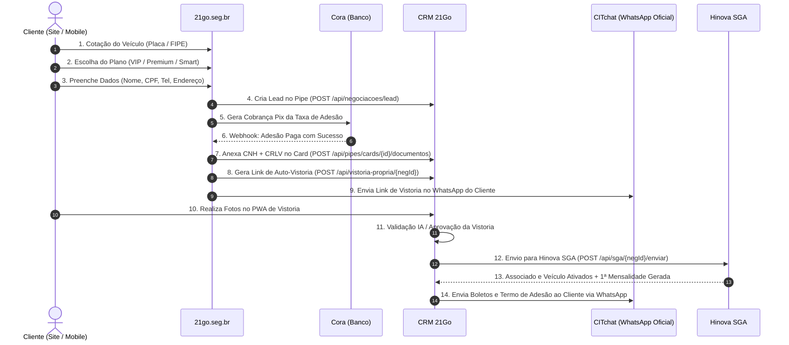

# 09 — Fluxo de Venda Automatizada 21Go

**Cora (Adesão Única) + CITchat/AtendeHub + CRM 21Go + Hinova SGA (Mensalidades Recorrentes)**

---

## 1. Regras de Negócio e Responsabilidades

| Componente | Responsabilidade | Mecanismo |
|---|---|---|
| **Taxa de Adesão (Entrada Única)** | **Cora** | Cobrança Pix / boleto instantâneo via API/Webhook Cora |
| **Mensalidades Recorrentes** | **CRM 21Go + Hinova SGA** | Boletos mensais gerados no SGA após a ativação do associado |
| **Disparo de Mensagens WhatsApp** | **CITchat (AtendeHub)** | Gateway oficial CITmax (`/gateway/sms`) |
| **Vistoria Digital Prévia** | **CRM 21Go (Vistoria Própria)** | Link PWA com câmera ao vivo, GPS e validação |

---

## 2. Fluxo Completo de Auto-Contratação



---

## 3. Endpoints e Orquestração Técnica

| # | Etapa | Endpoint / Ação | Responsável | Status |
|---|---|---|---|---|
| **1** | Criar lead / cotação | `POST /api/negociacoes/lead` | Backend | ✅ Ativo |
| **2** | Confirmar adesão única | `POST /api/webhooks/cora` | Cora -> Backend | 🔄 Em estruturação |
| **3** | Anexar CNH + CRLV | `POST /api/pipes/cards/{cardId}/documentos` | Backend | ✅ Mapeado |
| **4** | Gerar link de vistoria | `POST /api/vistoria-propria/{negociacaoId}` | CRM 21Go | ✅ Testado (200 OK) |
| **5** | Enviar link por WhatsApp | `POST /gateway/sms?token=...` | CITchat / AtendeHub | ✅ Testado (200 OK) |
| **6** | Cliente realiza vistoria | Link PWA oficial do CRM | Cliente | ✅ Mapeado |
| **7** | Enviar para Hinova SGA | `POST /api/sga/{negociacaoId}/enviar` | Backend / CRM | ✅ Mapeado |
| **8** | Obter boletos gerados | SGA Associado API v2.22 / Hinova | Hinova SGA | ✅ Documentado (docs/08) |
| **9** | Enviar boletos por WhatsApp | Gateway CITchat | CITchat | ✅ Testado (200 OK) |

---

## 4. Integração do Gateway CITchat (Validada em Produção)

- **URL de Disparo:**
  `https://atendehub.170.82.252.195.sslip.io/gateway/sms?token=ImQq5Lek2czuha3IPmPdXJ8EnBejCXpe`
- **Método:** `POST`
- **Headers:** `Content-Type: application/json`
- **Payload Homologado:**
```json
{
  "recipient": "5584992187662",
  "body": "🚗 Olá! Aqui é da 21Go Proteção Veicular. Segue seu link de vistoria digital: https://crm21go.site/vistoria/XXXX"
}
```
- **Resposta de Confirmação:**
```json
{
  "success": true,
  "recipient": "5584992187662",
  "status": "enviado_template",
  "janela": false
}
```

---

## 5. Pontos Críticos e Regras de Segurança

1. **Adesão vs Mensalidade:**
   - O Cora só cobra a taxa de adesão inicial (Pix único de ativação).
   - As mensalidades seguintes são geradas pelo Hinova SGA / CRM com vencimento nos dias cadastrados (ex: dia 10) e com o desconto de pontualidade de 5%.
2. **Pré-requisito da Vistoria:**
   - O link de auto-vistoria do CRM exige que o cadastro já possua CPF, CNH e CRLV do veículo.
3. **Ativação SGA:**
   - O disparo para o Hinova SGA (`POST /api/sga/{id}/enviar`) só é liberado após a aprovação das fotos da vistoria.
